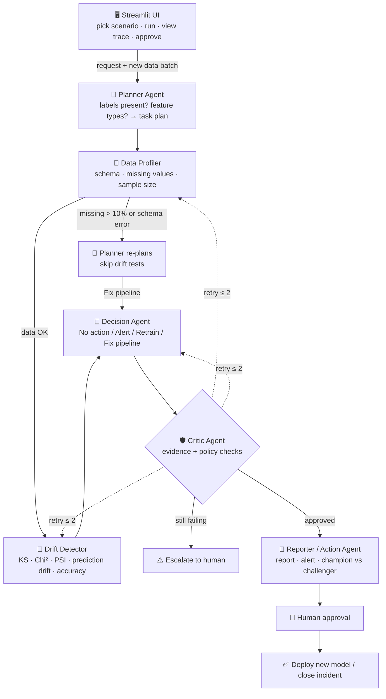

# 🛰️ Model Drift Watchdog

**An Agentic AI system that detects, decides, validates and acts when ML models go stale.**


> **CA-3: Domain-Specific Agentic AI Proof of Concept**
> Symbiosis Institute of Technology, Pune

| Team member | PRN |
|---|---|
| **Harsh Sharma** | 24070126067 |
| **Divyansh Agarwal** | 24070126056 |

**Domain:** MLOps (Machine Learning Operations), applied to a credit risk model at a digital lending company.

---

## 📌 Table of contents

1. [Problem statement](#1-problem-statement)
2. [Why this domain](#2-why-this-domain)
3. [Existing process vs proposed solution](#3-existing-process-vs-proposed-solution)
4. [Agents and responsibilities](#4-agents-and-responsibilities)
5. [Architecture](#5-architecture)
6. [Decision policy and Critic rules](#6-decision-policy-and-critic-rules)
7. [Demo scenarios (synthetic data)](#7-demo-scenarios-synthetic-data)
8. [Tech stack](#8-tech-stack)
9. [Project structure](#9-project-structure)
10. [Getting started](#10-getting-started)
11. [Validation plan](#11-validation-plan)
12. [Limitations and future scope](#12-limitations-and-future-scope)
13. [Roadmap](#13-roadmap)

---

## 1. Problem statement

Deployed machine learning models silently get worse when real-world data changes — a problem called **data drift**. Incomes rise with inflation, new kinds of customers (such as gig workers) start applying, or a broken data pipeline starts sending missing values.

The model keeps running, but it makes worse decisions. In lending, that means **risky loans get approved or good customers get rejected**, and nobody notices until losses appear months later.

Monitoring today is **manual, infrequent, and unable to tell real drift apart from a broken data pipeline**.

## 2. Why this domain

- 💸 **High financial stakes** — every wrong prediction is a bad loan or a lost customer.
- ⏳ **Label delay** — whether a loan defaults is known only months later, so accuracy can't be watched in real time. Monitoring the **input data** is the only early warning.
- ⚖️ **Regulatory risk** — lenders must be able to explain and audit automated credit decisions.
- 🏭 **Real industry pain** — monitoring and incident investigation take up a large share of ML teams' time.

## 3. Existing process vs proposed solution

| Aspect | ❌ Today (manual) | ✅ With Model Drift Watchdog |
|---|---|---|
| Frequency | Monthly or ad-hoc notebook checks | Every new data batch, automatically |
| Detection | After losses appear | Early, from input-data drift |
| Root cause | Engineers investigate by hand | Agents separate **real drift** from a **broken pipeline** |
| Decision | Gut feeling, inconsistent | Policy-based, **validated by a Critic agent** |
| Retraining | Manual and risky | Champion vs challenger comparison + **human approval** |
| Reporting | None or informal | Auto-generated report and alert |

**Impact:** faster detection · consistent decisions · fewer false alarms · full audit trail.

## 4. Agents and responsibilities

| Agent | Role type | Responsibility | Output |
|---|---|---|---|
| 🧭 **Planner** | Planner | Builds a task plan based on the data: picks tests per feature type, adds a performance check if labels exist, and **re-plans** if the Profiler finds bad data | Task plan |
| 🔎 **Data Profiler** | Research | Loads reference (training) and production data; checks schema, missing values, sample size and statistics | Data quality report |
| 📡 **Drift Detector** | Executor | Runs KS (numeric), Chi-square (categorical), PSI (all features), prediction drift, and accuracy if labels exist | Drift table |
| 🔀 **Decision Agent** | Business Automation | Applies the policy: **No action / Alert / Retrain / Fix pipeline** | Recommended action |
| 🛡️ **Critic** | Critic | Validates evidence and decision; triggers targeted retries (max 2) or escalates to a human | Approve / retry / escalate |
| 📝 **Reporter / Action** | Executor + Automation | Writes the report and alert; on Retrain, trains a challenger model and compares it with the champion | Report, alert, model comparison |
| 👤 **Human Approver** | Human-in-the-loop | Approves or rejects deploying the new model | Final sign-off |

All agents read and write **one shared state** (data, plan, results, decision, critic verdict, retry count). Orchestration is a **LangGraph state graph** whose conditional edges handle re-planning, Critic retries and escalation.

> **Design principle:** decisions come from statistics and rules, so they are **auditable and repeatable**. The LLM only *explains* them in plain English — it never makes the retrain decision itself.

## 5. Architecture



**Data:** `reference` training data · production batch (per scenario) · champion model
**Tools:** pandas · NumPy · SciPy (KS, Chi²) · custom PSI · scikit-learn · Plotly · LangGraph · Ollama / mock LLM

More detail: [`docs/architecture.md`](docs/architecture.md)

## 6. Decision policy and Critic rules

**Drift thresholds**

| Check | Threshold |
|---|---|
| PSI per feature | `< 0.10` stable · `0.10 – 0.25` moderate · `> 0.25` major |
| KS / Chi-square | `p < 0.05` → drifted |
| Data-quality issue | missing rate `> 10%` on any feature, or schema mismatch |
| Critical features | `credit_score`, `monthly_income`, `loan_amount`, `employment_type` |

**Decision rules**

| Condition | Decision |
|---|---|
| Data-quality issue | 🛠️ **Fix pipeline** (never retrain on bad data) |
| Major drift on a critical feature, **or** prediction PSI `> 0.25`, **or** accuracy drop `> 5` points | 🔁 **Retrain** |
| Moderate drift anywhere, **or** major drift on a non-critical feature | ⚠️ **Alert** |
| Otherwise | ✅ **No action** |

**Critic retry rules**

| Problem found | What happens |
|---|---|
| Sample size `< 500` | Profiler uses a larger data window |
| KS and PSI disagree on a critical feature | Detector re-checks with a bootstrap test |
| Decision breaks the policy | Decision agent revises it |
| Still failing after 2 retries | Escalate to a human |

**Deployment rule:** the challenger model is accepted only if its AUC is at least `0.01` higher than the champion's on fresh data **and** a human approves.

## 7. Demo scenarios (synthetic data)

Synthetic loan-applicant data — **5,000** training rows plus a **1,000**-row production batch per scenario.
Features: `age`, `monthly_income`, `loan_amount`, `credit_score`, `employment_type` (salaried / self-employed / gig), `city_tier` (1/2/3). Target: `default` (0/1).

| # | Scenario | What's injected | Expected outcome |
|---|---|---|---|
| 1 | Normal week | Nothing | ✅ No action |
| 2 | Gradual drift | Incomes up ~20%, city tier shifts slightly | ⚠️ Alert |
| 3 | Sudden drift | Large influx of gig workers, lower credit scores | 🔁 Retrain → challenger wins → human approves |
| 4 | Pipeline bug | 40% of `credit_score` values missing | 🛠️ Fix pipeline (**not** retrain) |

Scenario 4 is the key test: a naive system would retrain on broken data — our agents don't.

## 8. Tech stack

| Layer | Technology |
|---|---|
| Language | Python 3.10+ |
| UI | Streamlit |
| Orchestration | LangGraph (with a built-in fallback runner) |
| Statistics | SciPy (KS, Chi-square), custom PSI |
| ML | scikit-learn (Random Forest champion / challenger) |
| Data | pandas, NumPy (synthetic generator) |
| Charts | Plotly |
| LLM (optional) | Ollama local model for explanations, template-based mock fallback |

No paid APIs are used.

## 9. Project structure

```
model-drift-watchdog/
├── app.py                  # Streamlit UI (entry point)
├── data_gen.py             # Synthetic data + 4 drift scenarios
├── state.py                # Shared state passed between agents
├── policy.py               # Locked thresholds and decision rules
├── graph.py                # LangGraph orchestration (+ fallback runner)
├── llm.py                  # Ollama client + mock LLM
├── agents/
│   ├── planner.py          # Planner Agent
│   ├── profiler.py         # Data Profiler Agent
│   ├── detector.py         # Drift Detector Agent
│   ├── decision.py         # Decision Agent
│   ├── critic.py           # Critic Agent
│   └── reporter.py         # Reporter / Action Agent
├── data/                   # Generated datasets (git-ignored)
├── models/                 # Trained champion / challenger models (git-ignored)
├── docs/                   # Problem statement, architecture, validation plan
├── presentation/           # PPT for the CA-3 presentation
├── tests/                  # Validation tests
├── .streamlit/config.toml  # UI theme
└── requirements.txt
```

## 10. Getting started

```bash
# 1. Clone
git clone https://github.com/<your-username>/model-drift-watchdog.git
cd model-drift-watchdog

# 2. Create a virtual environment
python -m venv .venv
# Windows:  .venv\Scripts\activate
# macOS/Linux:  source .venv/bin/activate

# 3. Install dependencies
pip install -r requirements.txt

# 4. Run the app
streamlit run app.py
```

**Optional — local LLM explanations with Ollama**

```bash
# Install Ollama from https://ollama.com, then:
ollama pull llama3.2:3b
```

If Ollama isn't running, the app automatically uses the mock LLM, so the demo works on any laptop.

## 11. Validation plan

1. **Ground truth** — we know which drift was injected, so we compare each agent decision with the expected outcome for all 4 scenarios.
2. **Detection check** — truly drifted features vs features the Detector flagged.
3. **Critic checks** — sample size, test agreement and policy consistency, shown live in the UI.
4. **Model check** — the challenger must beat the champion on fresh data before deployment.
5. **Human check** — nothing is deployed without approval.

Details: [`docs/validation_plan.md`](docs/validation_plan.md)

## 12. Limitations and future scope

**Limitations**
- Synthetic data only
- Per-feature tests can miss combined (multivariate) drift
- Fixed thresholds, not learned
- Label delay not simulated
- Mock LLM explanations are template-based

**Future scope**
- Scheduled or real-time streaming monitoring
- Multivariate drift detection (classifier-based)
- MLflow model registry integration
- Slack / email alerts via MCP
- Canary rollout of new models and adaptive thresholds

## 13. Roadmap

- [x] Problem statement, domain and architecture finalised
- [x] Repository and project structure set up
- [ ] Synthetic data generator with 4 scenarios
- [ ] Agents: Planner, Profiler, Detector, Decision, Critic, Reporter
- [ ] LangGraph orchestration with retries and escalation
- [ ] Streamlit UI: agent trace, drift analysis, decision & critic, report & action, validation
- [ ] Ollama integration with mock fallback
- [ ] Validation run across all scenarios
- [ ] Final presentation and demo

---

## 📄 License

[MIT](LICENSE) © 2026 Harsh Sharma, Divyansh Agarwal
