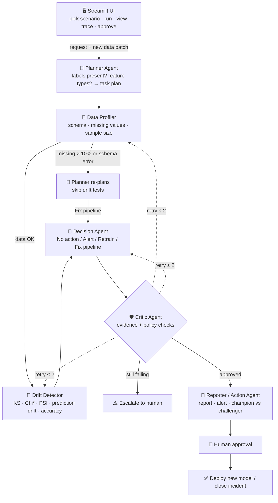

# Architecture

## Overview

Model Drift Watchdog is a multi-agent pipeline orchestrated as a **LangGraph state graph**. Every agent reads from and writes to one shared state object. Conditional edges let the workflow re-plan, retry and escalate instead of always running in a straight line.

## Agents

### 🧭 Planner Agent (Planner)
- **Input:** monitoring request, reference data schema, production batch metadata.
- **Does:** decides which checks to run — KS for numeric features, Chi-square for categorical, PSI for all, a performance check only if labels are present. If the Profiler reports a data-quality issue, it **re-plans**: drift tests are skipped and the run is routed to a Fix-pipeline decision.
- **Output:** ordered task plan.

### 🔎 Data Profiler (Research)
- **Input:** reference data, production batch.
- **Does:** schema comparison, missing-value rates, sample size, summary statistics per feature.
- **Output:** data quality report with a `data_ok` flag.

### 📡 Drift Detector (Executor)
- **Input:** task plan, both datasets, champion model.
- **Does:** per-feature KS / Chi-square p-values and PSI, prediction-distribution PSI, and accuracy/AUC drop when labels exist. On a Critic request, re-checks disputed features with a bootstrap test.
- **Output:** drift table with severity per feature.

### 🔀 Decision Agent (Business Automation)
- **Input:** drift table, data quality report.
- **Does:** applies the locked policy (see below) and records which rule fired.
- **Output:** one action — No action, Alert, Retrain or Fix pipeline — plus the triggering rule.

### 🛡️ Critic Agent (Critic)
- **Input:** full state.
- **Does:** verifies sample size, agreement between KS and PSI on critical features, and consistency between the decision and the policy. Sends work back to the right agent (max 2 retries), then escalates to a human if checks still fail.
- **Output:** approve / retry(target) / escalate, with a pass/fail checklist.

### 📝 Reporter / Action Agent (Executor + Business Automation)
- **Input:** approved state.
- **Does:** writes a plain-English report and an alert message (Ollama if available, otherwise template-based mock). On Retrain, trains a challenger on recent data and compares it with the champion on a fresh hold-out set.
- **Output:** report, alert, champion vs challenger comparison.

### 👤 Human Approver
- Approves or rejects deployment. Nothing is deployed automatically.

## Shared state

| Field | Written by | Description |
|---|---|---|
| `scenario`, `reference_df`, `production_df` | UI | Inputs for the run |
| `labels_available` | UI | Whether the production batch has true labels |
| `plan` | Planner | Ordered list of tasks |
| `quality_report` | Profiler | Schema, missing rates, sample size, `data_ok` |
| `drift_results` | Detector | Per-feature tests, PSI, severity, prediction drift, performance |
| `decision`, `decision_rule` | Decision | Recommended action and the rule that triggered it |
| `critic_verdict`, `critic_checks` | Critic | approve / retry / escalate and the checklist |
| `retry_count`, `retry_target` | Critic | Loop control (max 2) |
| `report`, `alert`, `model_comparison` | Reporter | Final outputs |
| `trace` | All agents | Step-by-step log shown in the UI |

## Decision policy

| Condition | Decision |
|---|---|
| Missing rate > 10% on any feature or schema mismatch | 🛠️ Fix pipeline |
| Major drift (PSI > 0.25) on a critical feature, prediction PSI > 0.25, or accuracy drop > 5 points | 🔁 Retrain |
| Moderate drift (PSI 0.10–0.25) anywhere, or major drift on a non-critical feature | ⚠️ Alert |
| Otherwise | ✅ No action |

Critical features: `credit_score`, `monthly_income`, `loan_amount`, `employment_type`.
Statistical significance: KS / Chi-square `p < 0.05`.

## Critic rules

| Problem | Action |
|---|---|
| Sample size < 500 | Retry Profiler with a larger window |
| KS and PSI disagree on a critical feature | Retry Detector with a bootstrap test |
| Decision inconsistent with policy | Retry Decision agent |
| Still failing after 2 retries | Escalate to human |

## Deployment rule

A challenger model replaces the champion only if its AUC is at least **0.01** higher on fresh data **and** a human approves.

## Why decisions are rule-based

Statistical tests and a fixed policy make every decision **auditable and repeatable** — important in a regulated domain like lending. The LLM is used only to explain decisions in plain language, so it can never invent a retrain decision.
