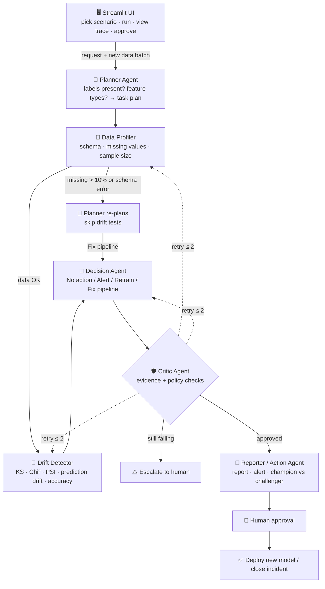

# Architecture

## Overview

Model Drift Watchdog is a multi-agent pipeline orchestrated as a **LangGraph state graph**. Every agent reads from and writes to one shared state object. Conditional edges let the workflow re-plan, retry and escalate instead of always running in a straight line.

## Agents

### 🧭 Planner Agent (Planner)
- **Input:** monitoring request, reference data schema, production batch metadata.
- **Does:** decides which checks to run — KS for numeric features, Chi-square for categorical, PSI for all, a performance check only if labels are present. If the Profiler reports a data-quality issue, it **re-plans**: drift tests are skipped and the run is routed to a Fix-pipeline decision.
- **Output:** ordered task plan.

### 🔎 Data Profiler (Research)
- **Input:** reference data, recent production data (newest first).
- **Does:** schema comparison, missing-value rates, sample size, summary statistics per feature. When the Critic asks for more data, it **doubles the window** (reads further back into recent production data).
- **Output:** data quality report with a `data_ok` flag.

### 📡 Drift Detector (Executor)
- **Input:** task plan, both datasets, champion model.
- **Does:** per-feature KS / Chi-square p-values and PSI, prediction-distribution PSI on the champion's risk scores, and accuracy/AUC vs the deployment baseline when labels exist. On a Critic request, re-checks disputed features with a **300-sample bootstrap** of PSI: if the 95% interval is below 0.10 the change is too small to matter; above 0.10 it is confirmed; in between it is treated as moderate (conservative).
- **Output:** drift table with severity per feature.

### 🔀 Decision Agent (Business Automation)
- **Input:** drift table, data quality report, performance.
- **Does:** applies the locked policy (see below) and records which rule fired and the evidence.
- **Output:** one action — No action, Alert, Retrain or Fix pipeline — plus the triggering rule.
- **Demo option:** "Inject a faulty first decision" makes the first call a naive rule, so the Critic can be shown catching it.

### 🛡️ Critic Agent (Critic)
- **Input:** full state.
- **Does:** runs 5 checks — sample size, KS/PSI agreement on critical features, never retrain on corrupted data, decision follows the policy (re-derived independently), decision backed by evidence. The first failing check decides where work goes back (Profiler / Detector / Decision). Max 2 retries, then escalates to a human.
- **Output:** approve / retry(target) / escalate, with a pass/fail checklist per round.

### 📝 Reporter / Action Agent (Executor + Business Automation)
- **Input:** approved (or escalated) state.
- **Does:** writes the drift report and a plain-English explanation (Ollama if available, otherwise template-based mock), routes an alert to the right team, opens an incident ticket for pipeline problems. On Retrain, trains a challenger on reference + recent labelled data (recent rows weighted 3×) and compares it with the champion on 2,000 fresh rows.
- **Output:** report, alert, incident, champion vs challenger comparison.

### 👤 Human Approver
- Approves or rejects deployment in the UI. Approved models go into the model registry (v1 → v2) and become the new champion. Escalations are acknowledged and assigned. Nothing is deployed automatically.

## Shared state

Defined in [`state.py`](../state.py). Each agent returns only the keys it changes.

| Field | Written by | Description |
|---|---|---|
| `scenario`, `reference_df`, `production_pool`, `champion`, `baseline_metrics` | UI / runner | Inputs for the run |
| `labels_available`, `batch_size`, `use_llm`, `inject_faulty_decision` | UI | Run settings |
| `plan`, `replanned` | Planner | Ordered task list; whether it re-planned |
| `window_size`, `production_df`, `quality_report` | Profiler | Monitored rows; schema, missing rates, sample size, `data_ok` |
| `drift_table`, `prediction_drift`, `performance`, `bootstrap_features` | Detector | Per-feature tests, PSI, severity, prediction drift, accuracy/AUC |
| `decision`, `decision_rule`, `decision_evidence`, `decision_round` | Decision | Recommended action, rule and evidence |
| `critic_verdict`, `critic_checks`, `critic_history` | Critic | approve / retry / escalate and every round's checklist |
| `retry_count`, `retry_target`, `escalated` | Critic | Loop control (max 2) |
| `report`, `explanation`, `alert`, `incident`, `model_comparison`, `challenger` | Reporter | Final outputs |
| `trace`, `path` | All agents | Step-by-step log and the nodes visited, shown in the UI |

## Orchestration

[`graph.py`](../graph.py) builds a LangGraph `StateGraph` with 7 nodes. Two routing functions drive the
conditional edges and are shared with a plain-Python fallback runner, so both engines give identical results
(this is tested).

| From | Condition | To |
|---|---|---|
| Profiler | `data_ok` | Detector |
| Profiler | data-quality issue | Planner (re-plan) → Decision |
| Critic | approve or escalate | Reporter |
| Critic | retry | Profiler / Detector / Decision |

## Knowledge base and memory

`knowledge.py` indexes the 21 documents in `knowledge_base/` with TF-IDF and exposes `cite()`, which retrieves the best
document for a query and records a citation (document, agent, reason, match score) in the shared state (`kb_refs`).

| Agent | Retrieves | Why |
|---|---|---|
| Planner | C-03 KS, C-04 Chi-square, C-02 PSI (+ D-02 if no labels); RB-04 on re-plan | Justify the chosen tests; route broken data |
| Drift Detector | C-06 prediction drift, C-07 bootstrap | Explain the extra checks it ran |
| Decision Agent | P-01 policy, P-02 critical features | The rule that fired |
| Critic Agent | P-03 critic rules; RB-05 on escalation | Its validation rules |
| Reporter / Action | Runbook for the final action (RB-01…RB-05), C-01, D-04, C-08, P-04 | Recommended steps, references, explanation context for the LLM |

The Reporter also reads and writes **agent memory** (`data/memory.jsonl`): it recalls past runs with the same decision
and overlapping drifted features, then saves the current run. Retrieval and memory never change a decision.

## Decision policy

| Condition | Decision |
|---|---|
| Missing rate > 10% on any feature or schema mismatch | 🛠️ Fix pipeline |
| Major drift (PSI > 0.25) on a critical feature, prediction PSI > 0.25, or accuracy drop > 5 points | 🔁 Retrain |
| Moderate drift (PSI 0.10–0.25) anywhere, or major drift on a non-critical feature | ⚠️ Alert |
| Otherwise | ✅ No action |

Critical features: `credit_score`, `monthly_income`, `loan_amount`, `employment_type`.
Statistical significance: KS / Chi-square `p < 0.05`.

## Critic rules

| Problem | Action |
|---|---|
| Sample size < 500 | Retry Profiler with a larger window |
| KS and PSI disagree on a critical feature | Retry Detector with a bootstrap test |
| Decision inconsistent with policy | Retry Decision agent |
| Still failing after 2 retries | Escalate to human |

## Deployment rule

A challenger model replaces the champion only if its AUC is at least **0.01** higher on fresh data **and** a human approves.

## Why decisions are rule-based

Statistical tests and a fixed policy make every decision **auditable and repeatable** — important in a regulated domain like lending. The LLM is used only to explain decisions in plain language, so it can never invent a retrain decision.
